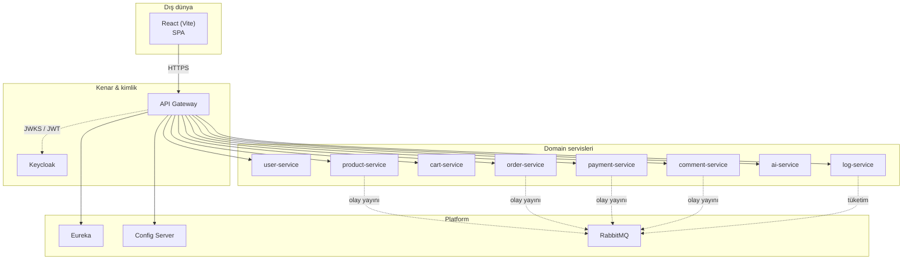
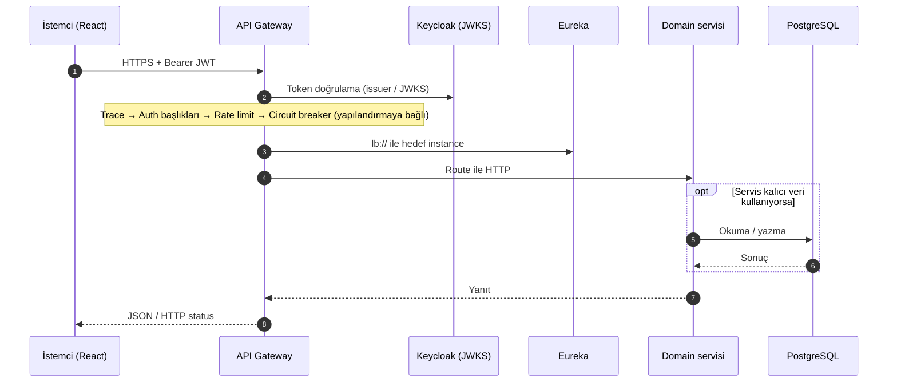
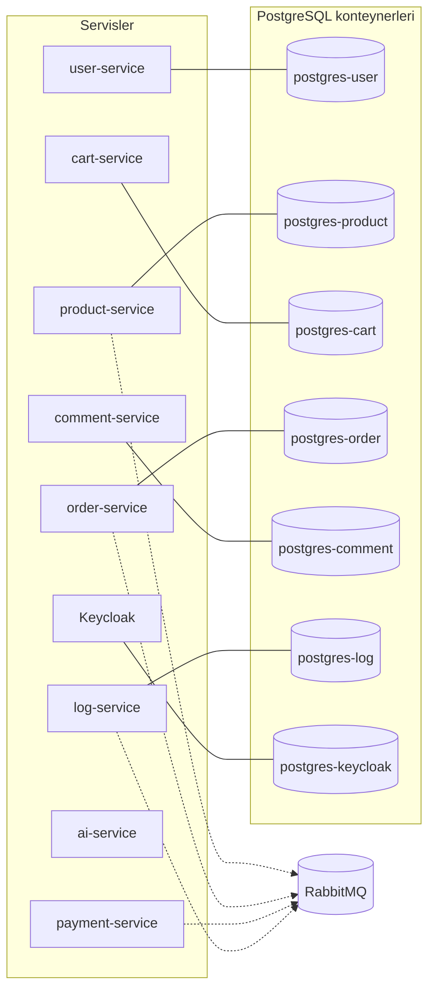

# N11 Bootcamp — E-Ticaret Mikroservis Projesi

Bu depo, **n11 Bootcamp** kapsamında geliştirilen **mikroservis mimarisindeki** bir e-ticaret sistemidir. Arka uç **Spring Boot 3** ve **Spring Cloud** ile; istemci tarafı **React (Vite)** ile sunulur. Altyapı **Docker Compose** ile ayağa kaldırılabilir; kalite için **unit/integration testler**, **GitHub Actions CI** ve merkezi **API dokümantasyonu (Swagger)** kullanılır.

---

## Bootcamp gereksinimleri ile eşleştirme

| Gereksinim | Projede karşılığı |
|------------|-------------------|
| RESTful API (ürün, sepet, sipariş) | `product-service`, `cart-service`, `order-service`; tek giriş: `api-gateway` |
| PostgreSQL | Servis bazlı Postgres konteynerleri (`infra/docker-compose.yml`) |
| Pagination | Ürün listelemede sayfalama (`Pageable`; detay: `backend/product-service`) |
| Sepet işlemleri | `cart-service` — ekleme, güncelleme, çıkarma |
| Sipariş yönetimi | `order-service` — oluşturma ve akış |
| Ödeme (Iyzico) | `payment-service` — `iyzipay-java` entegrasyonu |
| Güvenlik (JWT) | **Keycloak** ile OAuth2 / JWT; gateway **resource server** olarak doğrular |
| Unit & integration testler | Modül bazlı `src/test`; CI’da `mvn clean verify` |
| Swagger / OpenAPI | Springdoc; gateway üzerinden toplu Swagger UI |
| Loglama | `log-service` — saga/business olayları RabbitMQ üzerinden izlenebilir |
| Docker | Her servis için `Dockerfile`; tam stack `infra/docker-compose.yml` |
| CI/CD | `.github/workflows/ci.yml` — build, test, Docker image build |

**Nice-to-have örnekleri:** Gateway’de **rate limiting** ve **circuit breaker** (Resilience4j), `comment-service` (yorum/değerlendirme), `ai-service` (Gemini ile AI özellikleri — ortam değişkenleri `infra/.env.example` içinde).

---

## Mimari ve çalışma şemaları

Aşağıdaki diyagramlar GitHub **Markdown önizlemesinde** otomatik çizilir. VS Code’da görmek için Mermaid destekli Markdown önizlemesi kullanın.

### 1) Genel bileşenler (konteyner seviyesi)



### 2) Senkron istek akışı (HTTP — çalışma zinciri)



### 3) Veri ve mesajlaşma (`infra/docker-compose.yml` ile uyumlu özet)

Compose ortamında **servis başına ayrı Postgres** kullanılanlar çizilmiştir; `payment-service` bu stack’te ayrı bir Postgres konteynerine bağlı değildir (Iyzico + RabbitMQ odaklı); `ai-service` harici **Gemini API** kullanır.



### Kısa referans

| Bileşen | Rol |
|--------|-----|
| **Eureka (`discovery-service`)** | Servis kaydı ve keşfi (`lb://…`). |
| **Config Server (`config-service`)** | `config-repo/*.yml` — gateway route, JWT, Swagger toplu UI. |
| **API Gateway** | Tek giriş; JWT, filtreler, routing. |
| **RabbitMQ** | Saga / domain olayları; `log-service` tüketimi. |
| **common-lib** | Ortak DTO, event sabitleri, `HeaderConstants`. |

Detaylı mimari ve modül tablosu: **[backend/README.md](backend/README.md)**  
Gateway filtre sırası ve güvenlik: **[backend/api-gateway/README.md](backend/api-gateway/README.md)**

---

## Repo yapısı

```
.
├── backend/                 # Maven çok modüllü mikroservisler (Java 21)
│   ├── common-lib/
│   ├── discovery-service/
│   ├── config-service/
│   ├── api-gateway/
│   ├── user-service/
│   ├── product-service/
│   ├── cart-service/
│   ├── order-service/
│   ├── payment-service/
│   ├── comment-service/
│   ├── ai-service/
│   ├── log-service/
│   └── README.md            # Backend mimari özeti
├── frontend/
│   └── n11bootcamp-frontend/   # React + Vite + Keycloak JS
└── infra/
    ├── docker-compose.yml   # Tüm stack (Postgres, RabbitMQ, Keycloak, servisler…)
    └── .env.example         # Ortam değişkeni şablonu
```

Servis bazlı kısa notlar için her modül altında **README.md** dosyaları bulunur (ör. `backend/payment-service/README.md`).

---

## Ön koşullar

| Araç | Not |
|------|-----|
| **JDK 21** | Backend için |
| **Maven 3.9+** veya modül içindeki wrapper | `backend/mvnw*` varsa kullanılabilir |
| **Docker & Docker Compose** | Tam ortam için |
| **Node.js 20+** | Frontend geliştirme için |

---

## Hızlı başlangıç (Docker ile tam stack)

1. Ortam dosyasını oluşturun:

   ```bash
   cd infra
   copy .env.example .env
   ```

   `.env` içinde şifreleri, **Iyzico** sandbox anahtarlarını ve isteğe bağlı **GEMINI_API_KEY** değerini güncelleyin.

2. Stack’i derleyip çalıştırın:

   ```bash
   docker compose up -d --build
   ```

3. Tipik uç noktalar (varsayılan portlar `.env.example` ile uyumludur):

   | Bileşen | URL / port |
   |---------|------------|
   | API Gateway | `http://localhost:${GATEWAY_PORT:-8080}` |
   | Eureka | `http://localhost:${DISCOVERY_PORT:-8761}` |
   | Keycloak | `http://localhost:${KEYCLOAK_PORT:-8090}` |

   Korumalı API’ler için önce Keycloak üzerinden token alın; gateway JWT’yi doğrular ve mikroservislere `X-User-Id` / `X-User-Email` başlıklarını iletir.

---

## Backend — yerel geliştirme ve test

Tüm modülleri derlemek ve testleri çalıştırmak (CI ile aynı mantık):

```bash
cd backend
mvn -pl common-lib clean install -DskipTests -B
mvn clean verify -B
```

Tek bir servisi çalıştırmak için ilgili modül dizininde `mvn spring-boot:run` kullanılabilir. **Gerçek ortamda** sıra genelde: Eureka → Config Server → Gateway ve domain servisleri (detay: `backend/README.md`).

---

## Frontend

```bash
cd frontend/n11bootcamp-frontend
npm install
npm run dev
```

API tabanı genelde **gateway** adresine işaret eder; Keycloak ile giriş akışı `keycloak-js` üzerinden yürütülür.

---

## CI/CD

- **GitHub Actions:** [`.github/workflows/ci.yml`](.github/workflows/ci.yml)  
  - `common-lib` kurulumu  
  - `mvn clean verify` (tüm backend)  
  - `infra` altında `docker compose build`  
  - İsteğe bağlı Slack bildirimi (`vars.SLACK_ENABLED`, `secrets.SLACK_WEBHOOK_URL`)

Yerel önce CI ile aynı komutu çalıştırmak, push öncesi en güvenilir kontroldür.

---

## API dokümantasyonu

- Swagger UI genelde **gateway** üzerinden açılır; servis başına `api-docs` yolları config’te toplanır (`config-service` → `config-repo/api-gateway.yml` içinde `springdoc` ve route tanımları).

---

## Güvenlik notu

Production ortamında `.env` ve repository içinde **gerçek anahtarları** tutmayın; CI/CD’de GitHub **Secrets** kullanın. Keycloak realm ve istemci yapılandırması bootcamp dokümantasyonunuzla uyumlu olmalıdır.

---

## Ek kaynaklar

| Konu | Dosya |
|------|--------|
| Backend mimarisi | [backend/README.md](backend/README.md) |
| API Gateway (filtreler, Swagger, güvenlik) | [backend/api-gateway/README.md](backend/api-gateway/README.md) |
| Ortam şablonu | [infra/.env.example](infra/.env.example) |

---

*Bu README, teslim ve onboarding için üst seviye özet sunar; servis portları ve güncel profil ayarları ilgili `config-repo/*.yml` dosyalarında tutulur.*
