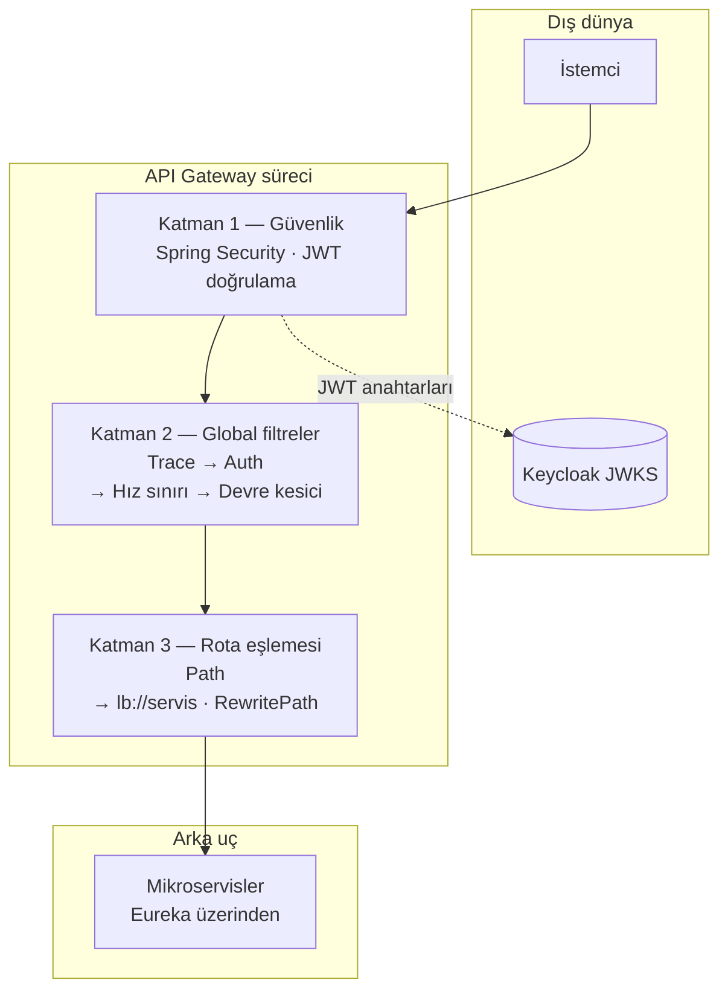
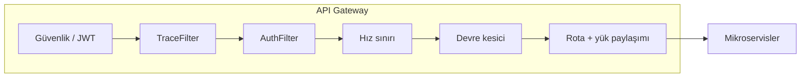

# API Gateway

Web ve mobil istemcilerin (React uygulaması, dış sistemler) arka taraftaki mikroservislere **tek adresten** ulaşmasını sağlayan **Spring Cloud Gateway** modülüdür. Gelen HTTP trafiğinde kimlik doğrulama, istek izleme, hız sınırı ve ihtiyaç duyulan yollarda dayanıklılık bu katmanda uygulanır.

---

## Altyapıdaki rolü

| Bileşen | Bu serviste ne işe yarıyor? |
|--------|-----------------------------|
| **Config Server** | Rotalar, JWT (JWKS), CORS, Swagger toplu ekranı, hız sınırı ve dayanıklılık ayarları `config-repo/api-gateway.yml` üzerinden merkezi yüklenir. |
| **Eureka (Discovery)** | `uri: lb://servis-adi` ifadesi, Kayıt defterinden (`service discovery`) çalışan örnekleri bularak **yükü paylaştıran** yönlendirme yapar. |
| **Keycloak** | **OAuth2 kaynak sunucusu** (Resource Server) ile JWT doğrulanır; token’daki kimlik bilgisi arka uç isteklerine HTTP başlığı olarak eklenir. |
| **common-lib** | `USER_ID`, `USER_EMAIL`, `X-TRACE-ID` gibi ortak başlık adları burada toplanır; gateway ile diğer servisler aynı anlaşmayı kullanır. |

Gateway yalnız çalıştırıldığında anlamlı değildir: **Config Server** ve **Eureka**; korumalı işlemler için de **Keycloak** erişilebilir olmalıdır.

---

## Mimari katmanlar

Alttaki şema, isteğin gateway içinden nasıl **yukarıdan aşağıya** aktığını özetler (GitHub / GitLab önizlemesinde diyagram olarak görünür).



**Kısa özet:** Önce **kimlik ve yetki**, sonra **sırayla filtreler**, en sonda **hangi URL’nin hangi servise gideceği** ve **yük paylaşımı**.

---

## İsteklerin işlenme sırası

1. **Spring Security (WebFlux)**  
   `SecurityConfig` kurallarına göre uç nokta ya **giriş gerektirmez** (`permitAll`) ya da **geçerli Bearer JWT** ister (`authenticated`). Korumalı yollarda token, yapılandırmadaki **JWKS** adresiyle doğrulanır.

2. **GlobalFilter zinciri** (öncelik: `@Order` değeri **küçük** olan önce)  

   | Öncelik | Sınıf | Kısaca |
   |---------|--------|--------|
   | En yüksek | `TraceFilter` | İstemci `X-Trace-ID` göndermediyse yeni bir tanımlayıcı üretir; isteğe ve yanıta aynı başlıkla ekler. |
   | +1 | `AuthFilter` | JWT varken Keycloak `subject` ve `email` değerlerini `USER_ID` / `USER_EMAIL` başlıklarına yazar; mikroservisler kullanıcıyı buradan okuyabilir. |
   | +2 | `RateLimitingFilter` | Açıksa ve yol **istisna listesinde değilse** Resilience4j ile **hız sınırı** uygular: önce başlıktaki kullanıcı → JWT `sub` → son çare IP. |
   | +3 | `GatewayCircuitBreakerFilter` | Yapılandırmadaki **korunan yol desenlerine** uyan isteklerde (örneğin ödeme) **devre kesici** ve **zaman aşımı sınırı** devreye girer; yoğun hata veya süre aşımında denetimli 503 yanıtı verilebilir. |

3. **Rota eşlemesi**  
   `spring.cloud.gateway.routes` içindeki **Path** koşulları isteği `lb://servis-adi` hedefine bağlar.

4. **Arka uç çağrısı**  
   Seçilen mikroservis örneğine vekil istek iletilir (gerekli başlıklar ve gövde korunur).



---

## Güvenlik özeti

- **Genel kural:** Çoğu `/api/v1/**` adresi kimlik doğrulaması ister.  
- **Kimlik doğrulamasız örnekler:** Ürün ve kategori için **GET**, yorumlar için **GET**, kullanıcı kaydı (`POST .../register`), Swagger ve izleme uçları (tam liste `SecurityConfig` içinde).  
- **`/api/v1/internal/**`** bilinçli olarak engellenir (`denyAll`).  

JWT doğrulaması **OAuth2 kaynak sunucusu** ile yapılır; token veren kurum (`issuer`) ve anahtar kümesi (`jwk-set-uri`) adresleri Config’ten gelir. Docker ile yerel makine arasında bu adreslerin ortama uyumlu olması gerekir.

---

## Arka uca iletilen başlıklar

Kimlik doğrulanmış isteklerde gateway, JWT’den çıkardığı bilgiyi şu HTTP başlıklarıyla iletir (adlar `common-lib` içindeki `HeaderConstants` ile aynıdır):

- **`USER_ID`** — Keycloak token’daki `subject`  
- **`USER_EMAIL`** — Token’daki `email` alanı  

Buna ek olarak **`X-TRACE-ID`** ile istekler uçtan uca ilişkilendirilir.

---

## Swagger / OpenAPI

Gateway üzerinde **tek bir Swagger arayüzü** açılır; her servisin OpenAPI tanımı, yol yeniden yazma (`RewritePath`) ile ilgili mikroservise yönlendirilir.

| Ne | Nerede |
|----|--------|
| Toplu arayüz | Örneğin `/swagger-ui.html` (`springdoc.swagger-ui.path`) |
| Servis dokümanı | Örneğin `/user-service/api-docs`, `/product-service/api-docs` |

Tüm liste `api-gateway.yml` dosyasındaki `springdoc` ve `routes` bölümlerindedir.

---

## Hız sınırı ve dayanıklılık

- **Hız sınırı (rate limiting):** `rate-limiting.*` altındaki ayarlar Config’te tutulur; Swagger, actuator ve dokümantasyon yolları çoğunlukla **istisna**dır.  
- **Devre kesici / zaman sınırı:** `gateway-resilience.*` ve `resilience4j.*` ile özellikle **ödeme** trafiği korunur; zaman aşımı veya devrenin açık kalması durumunda istemciye anlamlı bir JSON hata gövdesi dönülebilir.

Canlıya çıkmadan önce limit ve zaman aşımı değerleri gerçek trafiğe göre yeniden değerlendirilmelidir.

---

## CORS

Gateway, tarayıcıdan gelen çapraz köken isteklerinde izin verilen HTTP metotları ve başlıkları `globalcors` ile tek yerden yönetir. Geliştirme ortamında tüm kökenlere izin pratik olabilir; üretimde izin verilen adresler **dar ve bilinçli** seçilmelidir.

---

## Ayar dosyaları

| Kaynak | Dosya |
|--------|--------|
| Yerel önyükleme | `src/main/resources/application.yml` — Config Server adresi, uygulama adı |
| Asıl yapılandırma | `config-service/.../config-repo/api-gateway.yml` — rotalar, JWT adresleri, Swagger, hız sınırı, dayanıklılık |

---

## Çalıştırma

- Tüm bileşenleri birlikte ayağa kaldırmak için repo kökündeki **`infra`** altındaki Docker Compose düzenine bakın (önce keşif ve yapılandırma servisleri, sağlık kontrolleri).  
- Yalnız JAR ile çalıştırırken Config Server’ın erişilebilir olduğundan emin olun; `spring.config.import` başarısız olursa uygulama başlamaz.

---

## Kaynak kod haritası

Paket kökü: `src/main/java/com/n11bootcamp/api_gateway/`.

| Konu | Dosya veya paket |
|------|------------------|
| Uygulama girişi | `ApiGatewayApplication.java` |
| Güvenlik kuralları (JWT, permitAll) | `config/SecurityConfig.java` |
| İstek izi (`X-TRACE-ID`) | `filter/TraceFilter.java` |
| JWT → `USER_ID` / `USER_EMAIL` başlıkları | `filter/AuthFilter.java` |
| Hız sınırı filtresi | `filter/RateLimitingFilter.java` |
| Hız sınırı bean ve `@ConfigurationProperties` | `config/RateLimitingConfig.java`, `prop/RateLimitingProperties.java` |
| Ödeme vb. için devre kesici filtresi | `filter/GatewayCircuitBreakerFilter.java` |
| Dayanıklılık özellikleri ve ayar sınıfları | `config/GatewayResilienceConfig.java`, `prop/GatewayResilienceProperties.java` |
| Swagger/OpenAPI bean | `config/SwaggerConfig.java` |
| Konteyner görüntüsü | `Dockerfile` (çok modüllü Maven; `common-lib` dahil) |

```
api_gateway/
├── ApiGatewayApplication.java
├── config/          ← güvenlik, Swagger, rate limit / resilience bean’leri
├── filter/            ← Trace, Auth, RateLimiting, GatewayCircuitBreaker
└── prop/              ← RateLimitingProperties, GatewayResilienceProperties
```

---

## Konteyner görüntüsü (Jib yerine Dockerfile)

Çok modüllü yapıda **`common-lib`** bağımlılığı ve tek tip derleme için görüntü **Dockerfile** ile çok aşamalı Maven akışında üretilir. Bu nedenle projede **Jib** kullanılmıyor; süreç Dockerfile ile sabitlendi.
