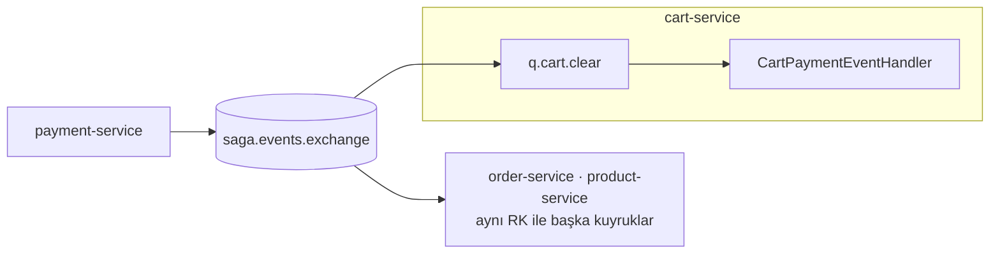

# Cart Service

Kullanıcı **sepet** verisini tutar; ürün bilgisi **product-service** üzerinden doğrulanır. Sipariş oluşturulurken **order-service** aktif sepeti dahili HTTP ile okur. Saga tarafında yalnızca **ödeme başarılı** olayından sonra sepet yaşam döngüsünü kapatır.

---

## Saga’daki rolü

Bu servis saga’da **olay yayınlamaz**; tek Rabbit tüketicisi vardır:

| Routing key | Kuyruk | Davranış |
|-------------|--------|-----------|
| **`payment.succeeded`** | `q.cart.clear` | Aktif sepet **`CartStatus.ORDERED`** ile kapatılır (`CartPaymentEventHandler` → `CartService.clearCart`). Kalemler silinmez; kayıt “siparişlendi” durumuna geçer. |

Ödeme başarısı **fan-out** ile aynı anda order ve product kuyruklarına da gider; sepet adımı **yan süreç** (para ve sipariş başka servislerde tamamlanır).

### Saga’da cart-service’in yeri (özet şema)

`payment.succeeded` tek routing key ile **üç ana dinleyiciye** gider; **cart-service** yalnızca **`q.cart.clear`** üzerinden devreye girer. Tam mutlu yol ve envanter adımları için bkz. [`product-service/README.md`](../product-service/README.md).

---

## Mimari (özet)

| Katman | İçerik |
|--------|--------|
| **`CartController`** | `/api/v1/cart` — ürün ekle/çıkar, miktar güncelle, aktif sepet (`X-User-Id`). |
| **`InternalCartController`** | `/internal/cart/{userId}/active` — **order-service** için aktif sepet snapshot’ı. |
| **`AdminCartController`** | Yönetim listesi / detay. |
| **`CartPaymentEventHandler`** | Saga: `PaymentSucceededEvent` işleyip `clearCart` çağırır. |
| **`CartEventConsumer`** | Yalnızca `Q_CART_CLEAR` dinleyicisi; mesajı handler’a iletir. |
| **`ProductServiceHelper`** | Ürün batch ve stok/fiyat için **HTTP** (`services.product.url` → product-service). |
| **`UserBehaviorEventPublisher`** | Sepet ekleme/çıkarma vb. davranış olayları (analytics). |

---

## RabbitMQ yapılandırması

| Sınıf | İçerik |
|--------|--------|
| **`RabbitCoreConfig`** | `Jackson2JsonMessageConverter`, `RabbitTemplate`, `rabbitListenerContainerFactory`. |
| **`SagaRabbitConfig`** | Topic exchange, DLX bean’i, `q.cart.clear` kuyruğu ve **`payment.succeeded`** binding’i. |

DLX argümanı RabbitMQ protokol adıdır; exchange adı **`SagaConstants.SAGA_DLX`**. Tam DLQ zinciri ortama göre infra ile tamamlanabilir (bkz. product-service README).

---

## Veri ve dış bağımlılıklar

- **PostgreSQL** — sepet ve kalemler; `common-lib` **`BaseEntity`** ile uyumlu silme modeli.
- **Config Server** — `cart-service.yml` (varsayılan port **8084**, RabbitMQ, **product** servis URL’si).
- **Eureka** — servis keşfi.
- **common-lib** — `ApiResponse`, `SagaConstants`, olay sınıfları, istisna kalıbı (`CartErrorCode`).

---

## İlgili dokümantasyon

| Konu | Dosya |
|------|--------|
| Sipariş oluşturma ve sepet okuma | [`../order-service/README.md`](../order-service/README.md) |
| Ödeme ve `payment.succeeded` yayını | [`../payment-service/README.md`](../payment-service/README.md) |
| Envanter / saga envanter adımı | [`../product-service/README.md`](../product-service/README.md) |
| Saga günlüğü ve kullanıcı davranışı kaydı | [`../log-service/README.md`](../log-service/README.md) |
| Ortak saga sabitleri | [`../common-lib/README.md`](../common-lib/README.md) |
| Merkezi yapılandırma | [`../config-service/README.md`](../config-service/README.md) |
