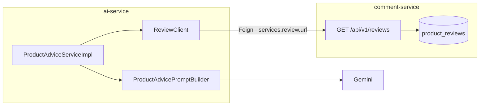

# Comment Service

**Ürün yorumları ve puanları** (1–5) tutar. Sipariş **saga** zincirine **dahil değildir**: RabbitMQ veya domain olayı yayınlamaz; kalıcılık **PostgreSQL**, erişim **HTTP** (API Gateway, admin, servisler arası dahili uçlar) üzerinden yapılır.

---

## Saga ile ilişki

**Yok.** Bu servis sipariş/envanter/ödeme adımlarından bağımsızdır; yalnızca `product_id` + `user_id` ile ilişkilendirilmiş yorum kaydı tutar.

---

## Üç API yüzeyi

| Yüzey | Base path | Kimlik / erişim | Kullanım |
|--------|-----------|-----------------|----------|
| **Kullanıcı** | `/api/v1/reviews` | `X-User-Id` (header) — oluşturma / güncelleme / silme | Ürüne yorum ekle, kendi yorumunu güncelle veya soft delete, ürüne göre sayfalı listele |
| **Admin** | `/api/v1/admin/reviews` | Yönetim (Gateway üzerinden rol ile kısıtlanır) | Herhangi bir yorum üzerinde CRUD + filtreli arama |
| **Internal** | `/internal/reviews` | Servisler arası (Docker / mesh içi); Gateway’de genelde **dışarı açılmaz** | Ürün bazlı yorum listesi — örn. başka mikroservis veya otomasyon (**varsayılan sayfa boyutu 50**) |

Gateway rotaları: **`/api/v1/reviews/**`**, **`/api/v1/admin/reviews/**`** (`api-gateway.yml`).

---

## AI servisi ile kullanım

**ai-service**, ürün hakkında soru-cevap / özet üretirken yorum metinlerini LLM bağlamına eklemek için **comment-service**’i çağırır.

- **Feign:** `ReviewClient` → yapılandırma **`services.review.url`** (ör. `http://comment-service:8087`).
- **Çağrı:** **`GET /api/v1/reviews`** — `productId`, sayfalama ve `sort` ile; kullanıcı header’ı **zorunlu değildir** (salt okuma listesi).
- **İş mantığı:** `ProductAdviceServiceImpl` sayfadaki yorumları alır, **en fazla 5** kaydı `ProductAdvicePromptBuilder` ile Gemini prompt’una koyar.

Yani üretimde AI tarafı pratikte **genel REST listesi** üzerinden bağlanır; **dahili `/internal/reviews`** aynı veriyi servis-servis senaryoları için alternatif olarak sunulur (path ve varsayılan sayfa boyutu farklıdır).

### Şema — AI ↔ comment-service

---

## Mimari (özet)

| Katman | İçerik |
|--------|--------|
| **`ProductReviewController`** | Kullanıcı CRUD + ürüne göre liste (`ratingMin` / `ratingMax` filtreleri). |
| **`AdminProductReviewController`** | Admin CRUD + çoklu filtre ile arama. |
| **`InternalProductReviewController`** | Dahili liste — ürün bazlı sayfalı yorumlar. |
| **`ProductReviewServiceImpl`** | İş kuralları; **`UserServiceClient`** (Feign) ile yanıtta **ad/soyad zenginleştirmesi**; kullanıcı servisi erişilemezse yorum yine döner (isimler boş kalabilir). |
| **`ProductReviewValidator`** | Puan aralığı (1–5), ürün başına kullanıcı başına **tek aktif yorum**, sahiplik (**403** başkasının kaydı için). |
| **`ProductReviewSpecification`** | JPA Specification ile silinmemiş kayıt + ürün/kullanıcı/puan filtresi. |

---

## Veri modeli

- Tablo **`product_reviews`**: `product_id`, `user_id`, `rating`, `comment`; **`(product_id, user_id)` unique** — aynı kullanıcı aynı ürüne ikinci aktif yorum yazamaz.
- **`BaseEntity`**: soft delete (`deleted`), zaman damgaları.

---

## Veri ve yapılandırma

- **PostgreSQL** — Config Server **`comment-service.yml`** (varsayılan port **8087**, `COMMENT_POSTGRES_*` ile infra uyumu).
- **Eureka**, **common-lib** (`ApiResponse`, `PageResponse`, `BusinessException`, `CommentErrorCode`).
- **Feign:** `UserServiceClient` → **`services.user.url`** (`/internal/users/{id}`).

---

## İlgili dokümantasyon

| Konu | Dosya |
|------|--------|
| Ürün bilgisi (AI ürün özeti ile birlikte) | [`../product-service/README.md`](../product-service/README.md) |
| LLM ürün tavsiyesi ve `ReviewClient` kodu | [`../ai-service`](../ai-service) (`ProductAdviceServiceImpl`, `ReviewClient`) |
| Kullanıcı profil okuma (Feign) | [`../user-service/README.md`](../user-service/README.md) |
| API girişi ve yorum rotaları | [`../api-gateway/README.md`](../api-gateway/README.md) |
| Merkezi yapılandırma | [`../config-service/README.md`](../config-service/README.md) |
