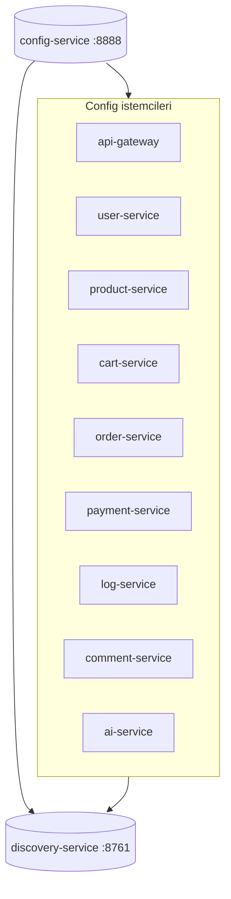

# Config Service

**Spring Cloud Config Server** ile tüm mikroservislerin yapılandırmasını **tek merkezden** sunan modüldür. Veritabanı bağlantıları, JWT adresleri, RabbitMQ, servisler arası URL’ler, gateway rotaları ve profil ayarları buradaki dosyalardan okunur; bu yüzden sistemin geri kalanı bu servisin ayakta ve erişilebilir olmasına bağlıdır.

---

## Neden kritik?

Diğer servisler açılışta şu satırı kullanır (`application.yaml` / `application.yml`):

```yaml
spring:
  config:
    import: "configserver:http://config-service:8888"
```

Config Server yanıt vermezse istemci **başlamaz** veya **yeniden deneme** ile bekler (servise göre `fail-fast` ayarı). Yani **discovery-service** hariç hemen her çalışan servis, doğrudan veya dolaylı olarak buraya muhtaçtır.

---

## Bu servisi kim kullanıyor?

| Durum | Servisler |
|--------|-----------|
| **Config istemcisi** (`spring-cloud-starter-config` + `configserver:...` import) | `api-gateway`, `user-service`, `product-service`, `cart-service`, `order-service`, `payment-service`, `log-service`, `comment-service`, `ai-service` |
| **Config kullanmıyor** | `discovery-service` (Eureka kendi `application.yml` ile çalışır), **bu modülün kendisi** (`config-service`) |

Özet: Ayar dosyaları burada toplanır; **asıl iş mantığı servisleri** açılışta buradan çeker.

---

## Nasıl çalışıyor?

1. **`@EnableConfigServer`** ile uygulama bir **yapılandırma sunucusu** olur; HTTP üzerinden `{isim}-{profil}.yml` benzeri isteklere yanıt verir.

2. **Depolama:** `spring.profiles.active: native` ve  
   `spring.cloud.config.server.native.search-locations: classpath:/config-repo`  
   ile ayarlar **JAR içindeki** `src/main/resources/config-repo/` klasöründen okunur (Git reposu yok; dağıtım ** Classpath native**).

3. **Dosya adları:** İstemci `spring.application.name` değeri ne ise (ör. `product-service`), sunucu genelde **`product-service.yml`** dosyasını birleştirir. Ortak parçalar için kökte **`application.yml`** kullanılır (tüm istemcilere uygulanabilen Eureka / actuator / springdoc iskeleti vb.).

4. **Eureka:** Config Service kendini Eureka’ya kaydeder (`config-service`, port **8888**). İstemciler çoğunlukla Docker ağında **`http://config-service:8888`** adresini doğrudan kullanır.

---

## Yapılandırma dosyalarının yeri

| Yol | İçerik |
|-----|--------|
| `config-service/src/main/resources/application.yml` | Sunucunun kendisi: port **8888**, **native** profil, `config-repo` arama yolu, Eureka istemcisi |
| `config-service/src/main/resources/config-repo/application.yml` | İstemcilere dağıtılan **ortak** taban (ör. Eureka istemci ayarı, actuator, springdoc iskelesi) |
| `config-service/src/main/resources/config-repo/*.yml` | Servis başına özel ayarlar |

**Servis başına özel dosyalar (örnek):**

`api-gateway.yml`, `user-service.yml`, `product-service.yml`, `cart-service.yml`, `order-service.yml`, `payment-service.yml`, `log-service.yml`, `comment-service.yml`, `ai-service.yml`

Gerçek anahtarlar (PostgreSQL host, Keycloak, İyzico, RabbitMQ, dahili URL’ler) bu dosyalarda tutulur; böylece kodda parola gömmek yerine ortam değişkenleri ile yönetilir.

---

## Bağımlılık zinciri (özeti)



- **Config Service**, hem istemcilere ayar verir hem Eureka’ya kayıt olur.  
- İstemciler önce Config’ten özelliklerini alır; içlerinde çoğu zaman **Eureka** ve **diğer servis URL’leri** de bu özelliklerdedir.

---

## Çalıştırma sırası (Docker / yerel)

Tipik güvenli sıra:

1. **discovery-service** (Eureka)  
2. **config-service**  
3. Diğer mikroservisler ve **api-gateway**

`infra` altındaki Compose düzeninde `depends_on` ve sağlık kontrolleri bu sırayı destekler; Config ayakta değilken gateway veya ürün servisi genelde **başarısız** olur.

---

## Yerel geliştirme notları

- İstemci `config-service` hostname’ini çözemediğinde import **başarısız** olur; yerelde `/etc/hosts` veya Compose ağı şart.  
- **Unit / integration testlerde** çoğu servis, gerçek Config’e gitmemek için test `application.yaml` ile `spring.config.import`’u ezer veya yerel ayar kullanır (ilgili servislerin `src/test/resources` dosyalarına bakın).

---

## Observability ve dokümantasyon

- **Actuator:** `health`, `info`, `env` açık (`management.endpoints.web.exposure`).  
- **Swagger:** `/swagger-ui.html`, `/api-docs` — Config Server’ın kendi API’si için.

---

## Kaynak kod haritası

```
config-service/
├── src/main/java/.../ConfigServiceApplication.java   ← @EnableConfigServer
├── src/main/resources/
│   ├── application.yml                               ← sunucu ayarı (native, port 8888)
│   └── config-repo/                                  ← tüm mikroservis YAML’ları
│       ├── application.yml
│       ├── api-gateway.yml
│       ├── user-service.yml
│       └── ...
└── Dockerfile
```

| Konu | Dosya |
|------|--------|
| Config Server etkinleştirme | `ConfigServiceApplication.java` |
| Sunucu profili ve depo konumu | `src/main/resources/application.yml` |
| Ortak istemci tabanı | `config-repo/application.yml` |
| Servis ayarları | `config-repo/<servis-adı>.yml` |
| Konteyner | `Dockerfile` |

---

## Özet

**Config Service**, projede “tek doğru yapılandırma kaynağı”dır; gateway rotalarından veritabanı şifrelerine kadar birçok değer buradan gelir. **Discovery Service** dışındaki çalışan servislerin çoğu doğrudan bu sunucuya bağlıdır; sistemi anlatırken “önce Eureka ve Config, sonra iş servisleri” düzenini vurgulamak doğru olur.
