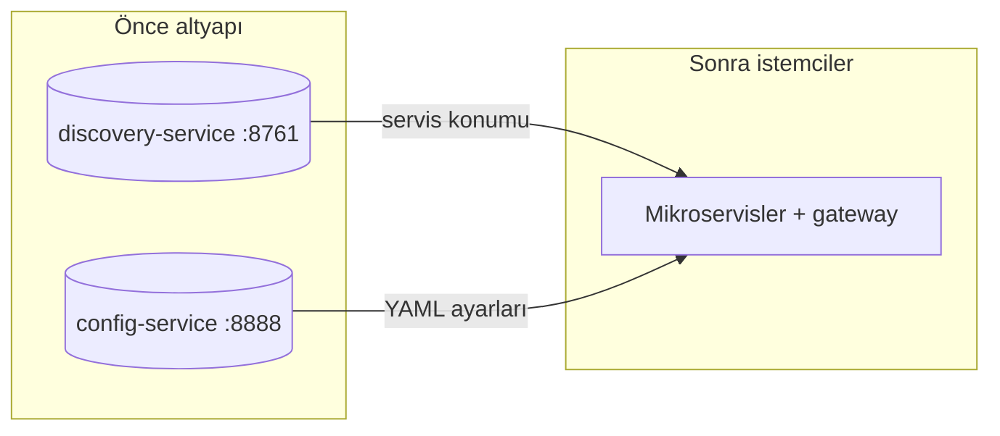

# Discovery Service

**Netflix Eureka** tabanlı **servis kayıt defteri** (service registry) modülüdür. Çalışan mikroservis örnekleri kendini buraya **kayıt** eder; **API Gateway** ve birbirlerine HTTP ile giden servisler, hedef adresi sabit yazmak yerine **`servis-adı`** ile buradan **dinamik** çözümler.

Config Server ayarları **ne çalışacağını** dağıtırken, Discovery **nerede çalıştığını** (IP/port örnekleri) tutar.

---

## Neden kritik?

- Gateway rotalarında kullanılan `uri: lb://product-service` ifadesi, Eureka’dan **product-service** kayıtlı örneklerini bulup **yük paylaştırarak** isteği iletir. Eureka ayakta değilse veya servis kayıtlı değilse **502 / bağlantı hatası** oluşabilir.
- Bu modül **Spring Cloud Config istemcisi değildir**: yapılandırma dosyası tek yerden **`config-service`** ile gelir; Discovery ise **yalnızca Eureka sunucusu** olarak çalışır (`discovery-service/src/main/resources/application.yml`).

---

## Bu servis ne yapıyor, ne yapmıyor?

| Yapılan | Yapılmayan |
|---------|------------|
| Servis örneklerinin kaydı ve sorgulanması | Ortak `application.yml` dağıtımı (bu **Config Server** işi) |
| Gateway ve istemciler için **mantıksal adres** (`http://product-service:8082` yerine `lb://product-service`) | İş kuralı veya API uygulama |

---

## Eureka sunucusu ayarları (özet)

| Ayar | Değer / anlam |
|------|----------------|
| Port | **8761** |
| `register-with-eureka` / `fetch-registry` | **false** — Sunucu kendi kayıt defterine **istemci gibi yazılmaz** ve başka defteri **çekmez**; tek düğüm Eureka için tipik ayardır. |
| `eureka.instance.hostname` | **discovery-service** — Docker ağında sabit isimle bulunur. |
| `peer-node-read-timeout-ms` | Tek düğüm / yoğun ortamda çoğaltma okuma zaman aşımı uyarılarını azaltmak için verilmiş süre. |

---

## Kim Eureka istemcisi?

Projede **Config Service**, **API Gateway** ve iş mikroservisleri (`user-service`, `product-service`, …) genelde **`spring-cloud-starter-netflix-eureka-client`** ile kendini Eureka’ya kaydeder ve kayıt listesini kullanır.

**Bu modülün kendisi** istemci değildir; yalnızca **Eureka Server** sürecidir.

---

## Config Service ile ilişki



- **Sıra:** Genelde önce **Discovery**, sonra **Config**, ardından diğer servisler ve gateway (Compose’ta `depends_on` / healthcheck ile uyumlu).  
- İstemci hem Eureka URL’sini (`config-repo/application.yml` içindeki `eureka.client.service-url.defaultZone`) hem de `spring.config.import` ile Config’i kullanır.

---

## Web arayüzü

Tarayıcıdan **`http://<host>:8761`** (Docker içinden örneğin `http://discovery-service:8761`) adresinde Eureka panosu açılır; hangi servisin **UP** olduğu ve örnek kimlikleri buradan izlenebilir.

---

## Observability

- **Actuator:** `health`, `info` dışa açık; konteyner **healthcheck** için `/actuator/health` kullanılabilir.

---

## Kaynak kod haritası

```
discovery-service/
├── src/main/java/.../DiscoveryServiceApplication.java   ← @EnableEurekaServer
├── src/main/resources/application.yml                   ← port 8761, tek düğüm Eureka
└── Dockerfile
```

| Konu | Dosya |
|------|--------|
| Eureka Server etkinleştirme | `DiscoveryServiceApplication.java` |
| Sunucu ve istemci (kendi kendine kayıt yok) ayarı | `src/main/resources/application.yml` |
| Konteyner | `Dockerfile` |

---

## Özet

**Discovery Service**, mikroservis mimarisinde **adres defteri** rolündedir; **Config Service** ile birlikte düşünüldüğünde altyapının iki ayağıdır: biri **ayar**, biri **konum**. Ana servisleri ve gateway’i anlatırken “rotalar `lb://` ile Eureka’ya dayanır” cümlesi bu modülün özetidir.

---

## İlgili dokümantasyon

- Merkezi yapılandırma: `../config-service/README.md`
- Tek HTTP girişi ve rotalar: `../api-gateway/README.md`
