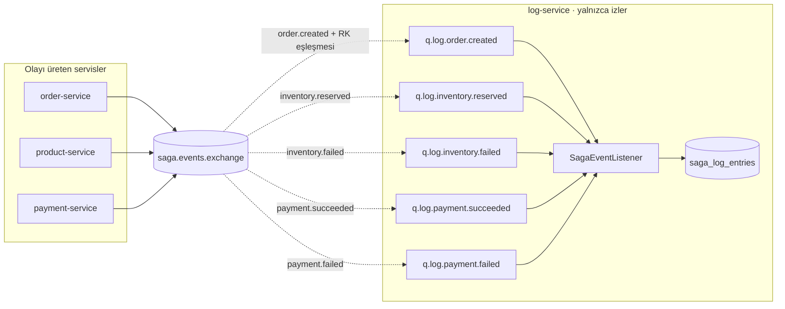
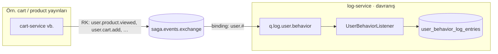
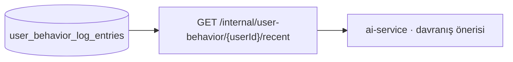

# Log Service

Bu servis **sipariş saga’sının iş kuralı adımı değildir**: orchestrator yok, sipariş/envanter/ödeme durumunu **güncellemez**. Aynı **`saga.events.exchange`** üzerinden gelen mesajların bir **kopyasını** dinleyerek **kalıcı günlük** üretir ve HTTP ile sorgulanabilir kılar. Ek olarak, **analitik / davranış** için **farklı routing key ailesi** (`user.#`) altında gelen olayları **ayrı tabloya** yazar.

Özetle **iki birbirinden bağımsız iş** vardır:

| İş | Amaç | Kayıt hedefi | Saga “kritik yolu” mu? |
|----|------|--------------|-------------------------|
| **Saga olay günlüğü** | Sipariş → envanter → ödeme zincirindeki olayların **zaman çizelgesi** (audit / debug) | `saga_log_entries` | **Hayır** — yan süreç; servis çökse bile diğer servisler kendi kuyruklarıyla çalışmaya devam eder. |
| **Kullanıcı davranışı** | Ürün görüntüleme, sepet ekleme vb. kayıt; **admin listeleri** ve **ai-service** tarafında davranışa dayalı öneri bağlamı | `user_behavior_log_entries` | **Hayır** — sipariş yaşam döngüsünden **bağımsız** bir olay ailesi (`user.*`). |

---

## 1) Saga olay günlüğü (exchange fan-out, izleyici rolü)

Diğer servisler (`order-service`, `product-service`, `payment-service` …) olayları **topic exchange**’e yayınlar. Log-service, **aynı routing key**’lere bağlı **yalnızca log’a özel kuyrukları** (`q.log.*`) tüketir; mesaj **iş akışı kuyruklarından** (`q.order.*`, `q.cart.*` vb.) **fiziksel olarak ayrıdır**.

Her başarılı işlemde **`SagaEventListener`** ilgili olayı **`SagaLogEntryService`** ile **`SagaLogEntry`** olarak saklar (payload JSON metin olarak).

### Şema — saga ile ilişki (yan süreç)

**Okuma:** `GET /api/v1/logs`, `/order/{orderId}`, `/user/{userId}`, `/service/{serviceName}` — **`LogController`**.

---

## 2) Kullanıcı davranışı kaydı (saga’dan ayrı kanal)

Sepet / ürün tarafında yayınlanan **`UserBehaviorEvent`** mesajları **`user.#`** pattern’i ile **`q.log.user.behavior`** kuyruğuna bağlanır. Bu akış **sipariş oluşturma veya ödeme zorunlu adımlarıyla ilişkilendirilmez**; amaç **ürün–kullanıcı etkileşimi** kaydıdır.

**AI tarafı (kısa):** **ai-service**, davranışa dayalı ürün önerisi üretirken **`LogServiceClient`** ile **`GET /internal/user-behavior/{userId}/recent`** çağırır; son kayıtlar özetlenip LLM (Gemini) prompt’una bağlam olarak girer (`BehaviorRecommendationService` / `BehaviorRecommendationPromptBuilder`). Yani bu tablo yalnızca analitik listesi değil, **öneri motoru için okuma kaynağı**dır.

### Şema — davranış pipeline’ı (saga şemasından bağımsız)

**Okuma:** `GET /api/v1/logs/user-behavior` ve filtre uçları — **`UserBehaviorLogController`**; servisler arası **ai-service** için **`UserBehaviorInternalController`**.  
**Not:** Davranış mesajında `userId` veya `productId` yoksa **`UserBehaviorListener`** kayıt atlaması yapar (saga günlüğü ile aynı kural değildir).

---

## Mimari (özet)

| Katman | Saga günlüğü | Kullanıcı davranışı |
|--------|----------------|----------------------|
| **Dinleyici** | `SagaEventListener` | `UserBehaviorListener` |
| **Servis** | `SagaLogEntryService` | `UserBehaviorLogService` |
| **Entity** | `SagaLogEntry` (`EventType`, `service_name`, `payload`, …) | `UserBehaviorLogEntry` (`UserBehaviorType`, ürün/kullanıcı, `occurred_at`, …) |
| **API** | `LogController` | `UserBehaviorLogController` · dahili **`UserBehaviorInternalController`** (ör. **ai-service** Feign) |

---

## RabbitMQ yapılandırması

| Sınıf | İçerik |
|--------|--------|
| **`RabbitMQConfig`** | `TopicExchange` (**`SagaConstants.SAGA_EXCHANGE`**), `q.log.*` kuyrukları, saga RK binding’leri + **`user.#`** → **`q.log.user.behavior`**, JSON converter, `RabbitTemplate`, listener factory (`missingQueuesFatal(false)`). |

---

## Veri ve yapılandırma

- **PostgreSQL** — `saga_log_entries` ve `user_behavior_log_entries` (ayrı tablolar; ortak `BaseEntity` zaman damgası).
- **Config Server** — `log-service.yml` (varsayılan port **8086**; datasource **`postgres-log` / `log_db`** ile infra uyumu için ortam değişkenleri).
- **Eureka** — keşif (API Gateway üzerinden erişim senaryosu).

---

## İlgili dokümantasyon

| Konu | Dosya |
|------|--------|
| Sipariş ve saga dinleyicileri | [`../order-service/README.md`](../order-service/README.md) |
| Ödeme olay yayını | [`../payment-service/README.md`](../payment-service/README.md) |
| Envanter adımı | [`../product-service/README.md`](../product-service/README.md) |
| Sepet ve davranış yayını | [`../cart-service/README.md`](../cart-service/README.md) |
| Saga sabitleri ve olay sınıfları | [`../common-lib/README.md`](../common-lib/README.md) |
| Merkezi yapılandırma | [`../config-service/README.md`](../config-service/README.md) |
| Davranış kayıtlarını LLM önerisinde kullanan servis | `../ai-service` (Feign: `LogServiceClient` → dahili davranış uçları) |
