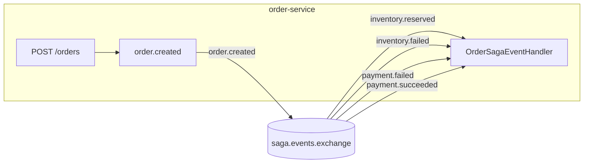

# Order Service

Sipariş kaydı ve **durum yaşam döngüsünün** tutulduğu mikroservistir. Sipariş oluşturulurken aktif sepet **cart-service** üzerinden **HTTP** ile okunur; saga’da **`OrderCreatedEvent`** yayınlanarak envanter adımı başlatılır. Ödeme çağrısı bu serviste değil (**payment-service**); sipariş durumu Rabbit olayları ve dahili okuma API’si ile güncellenir.

---

## Saga’daki rolü

Choreography modelinde **orkestratör yok**. Bu servis:

| Yön | Ne yapılır? |
|-----|--------------|
| **Yayın** | Sipariş kaydından sonra **`order.created`** routing key ile **`OrderCreatedEvent`** (`OrderEventPublisher`) → **product-service** stok rezervasyonunu tetikler. |
| **Tüketim** | Dört kuyruk üzerinden sipariş durumu güncellenir (`OrderSagaEventHandler` → `OrderService`). |

| Routing key (örnek) | Kuyruk | Sipariş durumu |
|---------------------|--------|----------------|
| **`inventory.reserved`** | `q.order.await.payment` | **PENDING** → **AWAITING_PAYMENT** |
| **`inventory.failed`** | `q.order.cancel.inventory` | **CANCELLED** (+ sebep) |
| **`payment.failed`** | `q.order.cancel.payment` | **CANCELLED** (+ sebep) |
| **`payment.succeeded`** | `q.order.complete` | **PAID** |

Durumlar `common-lib` **`OrderStatus`** ile uyumludur (`PENDING`, `AWAITING_PAYMENT`, `PAID`, `CANCELLED`).

### Saga’da order-service (özet şema)

**Not:** `payment.succeeded` ve `inventory.reserved` aynı exchange üzerinden **başka servislere** de gider (fan-out); şema order tarafını vurgular. Tam zincir için [`../product-service/README.md`](../product-service/README.md).

---

## Mimari (özet)

| Katman | İçerik |
|--------|--------|
| **`OrderController`** | `/api/v1/orders` — sipariş oluşturma (`X-User-Id`), sipariş detayı. |
| **`OrderInternalController`** | `/internal/orders/{id}` — **payment-service** ve diğer servisler için sipariş okuma. |
| **`AdminOrderController`** | Yönetim listesi / filtre. |
| **`OrderEventPublisher`** | Saga başlatma: `order.created`. |
| **`OrderEventConsumer`** | Dört `q.order.*` dinleyicisi; iş **`OrderSagaEventHandler`**. |
| **`CartServiceHelper`** | Aktif sepet (`services.cart.url` → cart-service). |

---

## RabbitMQ yapılandırması

| Sınıf | İçerik |
|--------|--------|
| **`RabbitCoreConfig`** | `Jackson2JsonMessageConverter`, `RabbitTemplate`, `rabbitListenerContainerFactory`. |
| **`SagaRabbitConfig`** | Topic exchange, DLX bean’i, sipariş saga kuyrukları ve binding’ler. |

DLX argümanları RabbitMQ protokolüdür; tam DLQ zinciri ortama göre infra ile tamamlanabilir.

---

## Veri ve dış bağımlılıklar

- **PostgreSQL** — sipariş ve kalemler.
- **Config Server** — `order-service.yml` (varsayılan port **8083**, RabbitMQ, **cart** URL’si).
- **Eureka**, **common-lib** (`OrderCreatedEvent`, `SagaConstants`, `ApiResponse`, `OrderErrorCode`).

---

## İlgili dokümantasyon

| Konu | Dosya |
|------|--------|
| Sepet ve dahili sepet okuma | [`../cart-service/README.md`](../cart-service/README.md) |
| Envanter saga adımı | [`../product-service/README.md`](../product-service/README.md) |
| Ödeme ve olay yayını | [`../payment-service/README.md`](../payment-service/README.md) |
| Saga / davranış günlükleri (yan süreç) | [`../log-service/README.md`](../log-service/README.md) |
| Ortak saga sabitleri | [`../common-lib/README.md`](../common-lib/README.md) |
| Merkezi yapılandırma | [`../config-service/README.md`](../config-service/README.md) |
