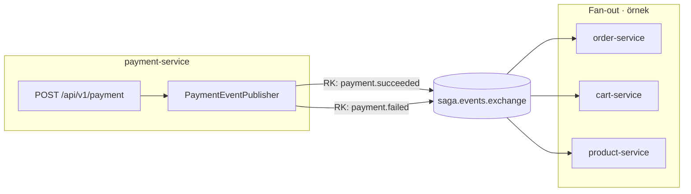
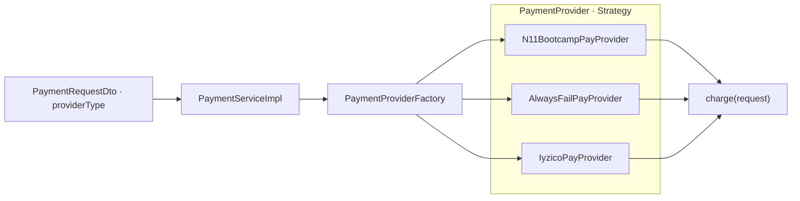

# Payment Service

Sipariş **ödemesini** tetikler: sipariş durumu **AWAITING_PAYMENT** olduğunda seçilen **ödeme sağlayıcısı** ile tahsilat dener. Sipariş özeti **order-service** üzerinden **Feign** ile okunur; başarı veya başarısızlıkta saga **topic exchange** üzerinden **`PaymentSucceededEvent`** veya **`PaymentFailedEvent`** yayınlanır. Bu serviste **Rabbit dinleyicisi yoktur** — yalnızca yayıncıdır (choreography’nin ödeme adımı).

---

## Saga’daki rolü

Choreography modelinde **orkestratör yok**. Bu servis:

| Yön | Ne yapılır? |
|-----|-------------|
| **HTTP giriş** | İstemci / API Gateway **`POST /api/v1/payment`** + **`X-User-Id`** ile ödeme isteği gönderir. |
| **Dış HTTP** | **`OrderClient`** → `order-service` **`/internal/orders/{id}`** ile sipariş doğrulanır (`AWAITING_PAYMENT` kontrolü). |
| **Yayın** | Tahsilat sonucuna göre **`PaymentEventPublisher`**: başarıda **`payment.succeeded`**, hatada **`payment.failed`** routing key ile **`saga.events.exchange`**’e mesaj gönderir. |

| Routing key | Olay | Tipik tüketici (örnek) |
|-------------|------|-------------------------|
| **`payment.succeeded`** | `PaymentSucceededEvent` | **order-service** (sipariş **PAID**), **cart-service** (`q.cart.clear`), **product-service** (envanter onayı vb.) — fan-out. |
| **`payment.failed`** | `PaymentFailedEvent` | **order-service** (`q.order.cancel.payment` → sipariş **CANCELLED**). |

### Saga’da payment-service (özet şema)

Aynı routing key ile exchange’den **birden fazla kuyruk** beslenebilir; aşağıdaki şema ödeme servisinin **yalnızca yayıncı** olduğunu ve olayların **order / cart / product** tarafına yayıldığını özetler.

Ödeme öncesi sipariş **`OrderClient`** ile **order-service** üzerinden okunur (şema içinde gösterilmedi).

Tam sipariş durum akışı için [`../order-service/README.md`](../order-service/README.md); envanter adımı için [`../product-service/README.md`](../product-service/README.md).

---

## Mimari (özet)

| Katman | İçerik |
|--------|--------|
| **`PaymentController`** | `/api/v1/payment` — ödeme başlatma (`X-User-Id`). |
| **`PaymentService` / `PaymentServiceImpl`** | Sipariş kontrolü, provider ile `charge`, olay yayını. |
| **`PaymentProviderFactory`** | `PaymentProviderType` → somut provider; bilinmeyen tip için `BusinessException` (`PaymentErrorCode.UNKNOWN_PAYMENT_PROVIDER`). |
| **`PaymentProvider`** | Örn. **`N11BootcampPayProvider`**, **`AlwaysFailPayProvider`**, **`IyzicoPayProvider`** (yapılandırmaya bağlı). |
| **`PaymentEventPublisher`** | `PaymentSucceededEvent` / `PaymentFailedEvent` → `SagaConstants.SAGA_EXCHANGE`. |
| **`OrderClient`** | Feign — **`order-service`** dahili sipariş okuma. |

---

## Ödeme tipine göre işlem (Strategy + Factory)

Ödeme kaynağı seçimi için **Builder** deseni kullanılmıyor (Builder tipik olarak istek/DTO nesnelerinin adım adım kurulması içindir — örn. Lombok `@Builder`). Kanal seçimi burada **Strategy** ve **basit Factory / kayıt** ile yapılıyor:

| Kavram | Bu projede |
|--------|------------|
| **Strategy** | **`PaymentProvider`** arayüzü — her ödeme tipi (`PaymentProviderType`) için ayrı sınıf: `charge(PaymentRequest)` davranışı (`N11BootcampPayProvider`, `AlwaysFailPayProvider`, `IyzicoPayProvider` vb.). |
| **Factory** | **`PaymentProviderFactory`** — istekteki **`PaymentProviderType`** ile doğru strateji örneğini seçer. Spring başlangıçta tüm **`PaymentProvider`** bean’lerini enjekte eder; factory bunları `Map<PaymentProviderType, PaymentProvider>` olarak tutar. Bilinmeyen tip için **`BusinessException`** (`UNKNOWN_PAYMENT_PROVIDER`). |

Yeni bir ödeme tipi eklemek: `common-lib` **`PaymentProviderType`** enum’una değer + yeni **`PaymentProvider`** implementasyonu — factory sınıfına ek dallanma yazmak gerekmez.

### Özet şema

---

## RabbitMQ yapılandırması

| Sınıf | İçerik |
|--------|--------|
| **`RabbitCoreConfig`** | `Jackson2JsonMessageConverter`, `RabbitTemplate`. |
| **`SagaPublisherConfig`** | Topic exchange **`saga.events.exchange`**, DLX bean **`saga.events.dlx`** — **kuyruk ve listener tanımı yok** (yalnızca yayın için gerekli bean’ler). |

Tüketici kuyrukları **order-service**, **cart-service**, **product-service** modüllerinde tanımlıdır.

---

## Veri ve dış bağımlılıklar

- Kalıcı veritabanı **zorunlu değildir** — ödeme akışı istek bazlıdır; test profili H2 kullanabilir.
- **Config Server** — `payment-service.yml` (varsayılan port **8085**, RabbitMQ, İyzico sandbox anahtarları).
- **Eureka** — Feign ile **order-service** keşfi.
- **common-lib** — `PaymentSucceededEvent`, `PaymentFailedEvent`, `SagaConstants`, `PaymentProviderType`, `ApiResponse`, `BusinessException` / `PaymentErrorCode`.

---

## İlgili dokümantasyon

| Konu | Dosya |
|------|--------|
| Sipariş durumu ve saga dinleyicileri | [`../order-service/README.md`](../order-service/README.md) |
| Ödeme sonrası sepet (`payment.succeeded` → `q.cart.clear`) | [`../cart-service/README.md`](../cart-service/README.md) |
| Envanter ve `OrderCreatedEvent` zinciri | [`../product-service/README.md`](../product-service/README.md) |
| Ortak saga sabitleri ve olay sınıfları | [`../common-lib/README.md`](../common-lib/README.md) |
| Olayların kalıcı günlüğü (log-service) | [`../log-service/README.md`](../log-service/README.md) |
| Merkezi yapılandırma | [`../config-service/README.md`](../config-service/README.md) |
