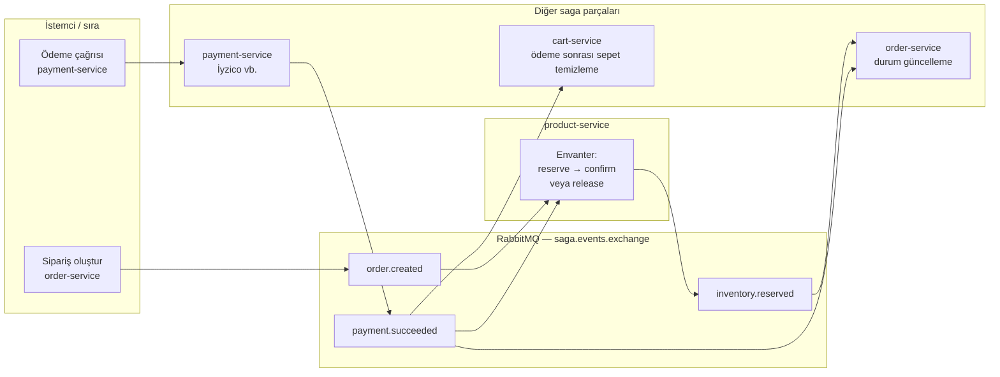

# Product Service

Ürün ve kategori **REST API**’si, müşteri davranışı için olay yayını ve saga akışında **envanter (stok) adımının** tek sahibi. Stok; rezerve edilir, ödeme başarısızsa serbest bırakılır, ödeme başarılıysa satış kesinleşir (`quantity` / `reservedQuantity` modeli).

---

## Saga’daki rolü (özet)

Projede saga **orkestratör yok**; **choreography**: ortak **`saga.events.exchange`** topic exchange ve **`SagaConstants`** içindeki routing key’ler ile servisler birbirini olaylarla tetikler.

**Product service** yalnızca **stok** ile ilgilenir:

| Aşama | Tetik (routing key) | Bu serviste ne olur? | Sonraki olay (yayın / dinleyen) |
|--------|----------------------|----------------------|--------------------------------|
| 1 | **`order.created`** → `q.inventory.reserve` | Sipariş kalemleri için sırayla **`reserveStock`**; başarılıysa **`inventory.reserved`** yayınlanır | **order-service** siparişi `AWAITING_PAYMENT` yapar |
| 1 (hata) | — | Rezervasyon sırasında hata → kısmi rezervasyon geri alınır, **`inventory.failed`** | **order-service** siparişi iptal eder |
| 2 | **`payment.failed`** → `q.inventory.release` | Kalemler için **`releaseReservedStock`** | Sipariş zaten order tarafında iptal |
| 3 | **`payment.succeeded`** → `q.inventory.confirm` | Kalemler için **`confirmStock`** (stoktan düşüm + rezerve azaltma) | Sepet **cart-service** tarafında ayrı kuyrukta temizlenir |

Ödeme çağrısı **REST** ile **payment-service** üzerinden yapılır; product doğrudan ödeme bilmez, sadece ödeme **sonucunun** yayınladığı olayları dinler.

---

## Saga’nın genel görünümü (servisler arası)

Aşağıdaki şema **mutlu yolu** ve product’un neresinde durduğunu gösterir (GitHub önizlemesinde diyagram çizilir).

**Fan-out:** `payment.succeeded` tek routing key ile birden fazla kuyruğa gider (sipariş tamamlama, envanter onayı, sepet temizliği). Product yalnızca **envanter onayı** kuyruğunu dinler.

---

## Bu modülde saga kod girişleri

| Bileşen | Görev |
|---------|--------|
| **`InventoryEventConsumer`** | Üç kuyruk için `@RabbitListener`: `Q_INVENTORY_RESERVE`, `Q_INVENTORY_RELEASE`, `Q_INVENTORY_CONFIRM` |
| **`InventoryEventHandler`** | Olay gövdesinden kalemleri okuyup `ProductService.reserveStock` / `releaseReservedStock` / `confirmStock` çağırır; gerekirse **`RabbitTemplate`** ile `inventory.reserved` veya `inventory.failed` yayınlar |

Domain kuralları **`Product`** entity ve **`ProductServiceImpl`** içinde (ör. `findByIdForUpdate` ile eşzamanlı güncelleme).

---

## Kuyruk ↔ routing key bağlantısı

`SagaRabbitConfig` içinde tanımlı binding’ler:

| Kuyruk (`SagaConstants`) | Routing key | Dinlenen olay tipi |
|--------------------------|---------------|---------------------|
| `q.inventory.reserve` | `order.created` | `OrderCreatedEvent` |
| `q.inventory.release` | `payment.failed` | `PaymentFailedEvent` |
| `q.inventory.confirm` | `payment.succeeded` | `PaymentSucceededEvent` |

---

## RabbitMQ yapılandırması (Spring)

| Sınıf | İçerik |
|--------|--------|
| **`RabbitCoreConfig`** | `Jackson2JsonMessageConverter`, `RabbitTemplate`, `SimpleRabbitListenerContainerFactory` |
| **`SagaRabbitConfig`** | Saga topic exchange, DLX bean'i, envanter kuyrukları ve binding'ler |

### DLX (`saga.events.dlx`) notu

Kuyruklar **`x-dead-letter-exchange`** ile DLX'e işaret eder; uygulama içinde **`DirectExchange` bean'i** bu isimle oluşturulur ki broker tarafında exchange mevcut olsun.

**DLQ kuyruğu** ve DLX'ten DLQ'ya **binding** bu modülde tanımlı değildir; tam ölü mektup zinciri infra (Compose), RabbitMQ yönetim arayüzü veya başka bir ortam betiği ile tamamlanabilir. Bu yüzden geliştirme ortamında yalnızca DLX bean'i ve kuyruk argümanları görünüp DLQ tarafı eksik kalabilir — beklenen bir durumdur.

---

## Teknoloji ve veri

- **PostgreSQL** + JPA; ürün/kategori tabloları ve stok alanları.
- **Eureka**, **Config Server** (`product-service.yml`), **common-lib** (olay sınıfları, `SagaConstants`, `ApiResponse`, istisna kalıbı).
- Davranış analitiği için Rabbit üzerinden kullanıcı olayları (`UserBehaviorEventPublisher`).

---

## İlgili dokümantasyon

| Konu | Dosya |
|------|--------|
| Ortak saga sabitleri ve olay sınıfları | [`../common-lib/README.md`](../common-lib/README.md) |
| Sipariş oluşturma, `OrderCreatedEvent`, sipariş durumu dinleyicileri | [`../order-service/README.md`](../order-service/README.md) |
| Ödeme, İyzico, `payment.succeeded` / `payment.failed` yayınları | [`../payment-service/README.md`](../payment-service/README.md) |
| Ödeme sonrası sepet temizliği (`q.cart.clear`) | [`../cart-service/README.md`](../cart-service/README.md) |
| Ürün yorumları / rating (AI bağlamı dahil) | [`../comment-service/README.md`](../comment-service/README.md) |
| Saga olaylarının loglanması / izlenmesi | [`../log-service/README.md`](../log-service/README.md) |
| Merkezi yapılandırma (tüm `*-service.yml`) | [`../config-service/README.md`](../config-service/README.md) |
| Tek HTTP girişi, JWT, rotalar | [`../api-gateway/README.md`](../api-gateway/README.md) |
